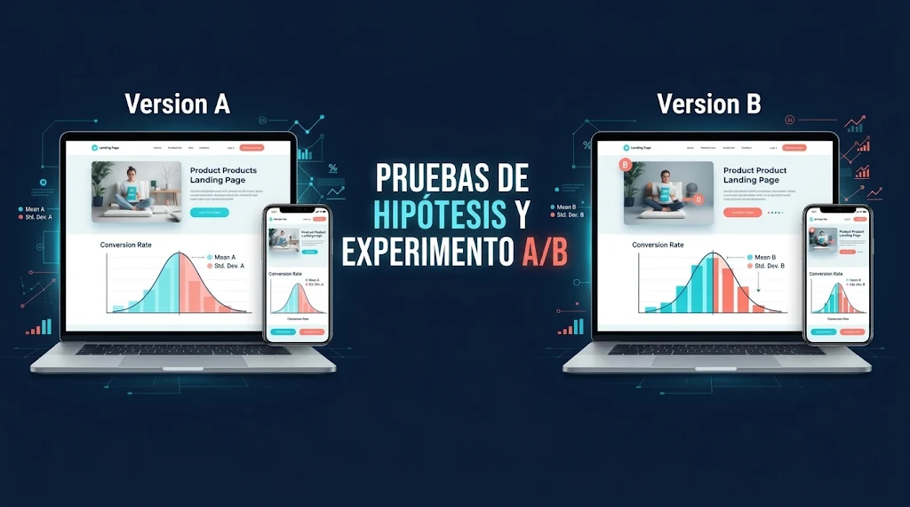

# Validando hipótesis de negocio con pruebas estadísticas — Experimento A/B en Landing Page

Evaluación estadística de un experimento A/B (`landing_experiment.csv`, versiones **A** y **B**) para determinar qué versión de la página de inicio conviene implementar, analizando **tasa de conversión**, **gasto promedio en usuarios convertidos** y comportamiento por **canal de tráfico**, **tipo de usuario**, **región** y **dispositivo**.

## 📂 Contenido del repositorio
* `landing_ab_experiment.ipynb` — *Notebook* con validación de datos, pruebas de hipótesis, análisis por segmentos, visualizaciones y recomendaciones de negocio.

## ▶ Cómo abrir y reproducir el análisis
1. Abre el archivo `.ipynb` directamente en GitHub o en **Google Colab**.
2. Ejecuta las celdas de arriba hacia abajo (requiere `pandas`, `numpy`, `scipy`, `statsmodels`, `matplotlib` y `seaborn`).
3. Revisa los resultados estadísticos (*estadístico de prueba*, *valor p* y tamaño/dirección del efecto) junto con las conclusiones de negocio.

## 💡 Preguntas clave abordadas
* ¿Existe diferencia significativa en el **gasto promedio por usuario convertido** (`converted == 1`) entre las versiones A y B?
* ¿Qué versión (**A** o **B**) logra mayor **tasa de conversión**?
* ¿Cómo influyen **`traffic_source`** y **`user_type`** (`Nuevo` vs. `Recurrente`) en la conversión?
* ¿Qué decisión y acciones recomiendan los datos para *marketing digital* y *landing page*?

## 📊 Conclusiones y recomendaciones clave
* **Ganador claro del experimento (versión B):** La **página B** supera de forma estadísticamente significativa a la **página A** tanto en **tasa de conversión** (**15.96%** vs. **12.57%**, diferencia de **3.38 puntos porcentuales**, *valor p* < 0.001) como en **gasto promedio por usuario convertido** (*t* = -9.37, *valor p* < 0.001), aportando mayor conversión y mayor ticket promedio por compra.
* **Canal de tráfico:** Aunque existe una asociación estadísticamente significativa entre `traffic_source` y `converted` (*valor p* = 0.034), la brecha práctica entre canales es estrecha (**13.79%** en *Organic* a **14.99%** en *Email*, apenas **1.2 puntos porcentuales**), por lo que conviene evaluar volumen y costo de adquisición (CAC) antes de hacer cambios bruscos de presupuesto.
* **Tipo de usuario:** No hay diferencia estadísticamente significativa entre usuarios **Nuevos** (**14.36%**) y **Recurrentes** (**14.09%**, *valor p* = 0.474), lo que indica que la página rinde de forma consistente en ambos perfiles sin requerir embudos separados por tipo de usuario.
* **Recomendación de negocio:** Desplegar la **versión B** al **100%** del tráfico y priorizar la eficiencia/ROAS de los canales de mayor volumen (*Organic* y *Ads*).
